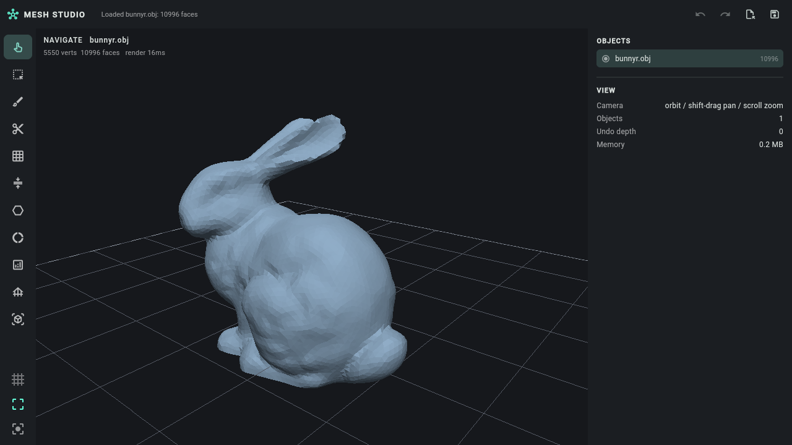
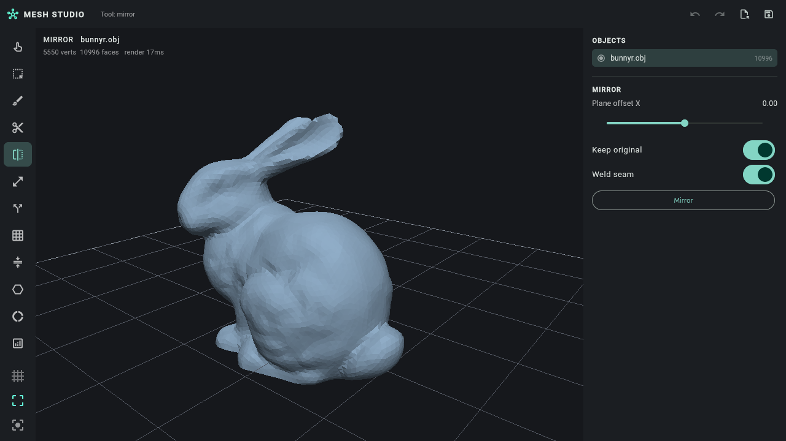

# mmx — a cross-platform mesh studio

A clean-room, from-scratch reimplementation of the useful parts of **Autodesk
Meshmixer 3.5.0**, based on reverse engineering the shipped Windows binary, plus
the reverse-engineering report itself.

* Reverse engineering: [`docs/REVERSE-ENGINEERING.md`](docs/REVERSE-ENGINEERING.md)
* Architecture and technology rationale: [`docs/ARCHITECTURE.md`](docs/ARCHITECTURE.md)
* Kernel: [`packages/mmx_core`](packages/mmx_core) (pure Dart, no Flutter dependency)
* App: [`apps/mmx_studio`](apps/mmx_studio) (Flutter: Windows, macOS, Linux;
  Android/iOS scaffolds included)




## What it does

Geometry kernel (Dart, AOT):

* import/export OBJ, PLY, STL (binary + ASCII), OFF, 3MF (OPC zip, no deps),
  and `.mix` (native Meshmixer scenes, binary-compatible with 3.5.0)
* topology: CSR adjacency, edge incidence, boundary loops, components,
  manifold checks
* repair: weld, crack closing, hole filling (flat/smooth), non-manifold
  splitting, defect inspector (holes / non-manifold / small shells)
* remesh: isotropic split/collapse/flip/relax/reproject with boundary and sharp
  constraints
* reduce: quadric-error decimation with boundary quadrics, face budget or
  percentage
* solid: narrow-band SDF voxelization, surface-nets polygonization,
  Make Solid (blocky/fast/accurate), offset, hollow with escape holes,
  boolean union/intersection/difference
* analysis: wall thickness, overhang, stability (COM/support polygon/tip angle),
  deviation, mass properties
* fabrication: support forest (tapered posts, bases, struts), orientation
  search, 2D bed packing, layer slicing
* tools: plane cut with capping, mirror with seam welding, selection extrude
  with a generated skirt, shell separation, normal flipping (selection or
  whole mesh), Taubin surface smoothing, bed placement, duplication, joining,
  grid pattern arrays, primitive fitting (box/cylinder/sphere), measurement
  (dimensions/area/volume/shells/watertightness), inter-object clearance,
  sculpt brushes (draw/inflate/flatten/pinch/smooth/move) with dynamic
  refinement, selection sets, face groups, soft transform
* remesh: isotropic split/collapse/flip/relax/reproject with boundary and sharp
  constraints, plus group-aware variational mode that pins internal face-group
  seams and carries groups onto the output
* rendering: orbit camera, z-buffer rasterizer, PNG output

App: object browser, tool rail, per-tool parameter panels, sculpt/select with
the mouse, analysis heat maps, supports, packing, undo/redo, export. The layout
collapses the properties panel into a drawer below 900 px so the same build is
usable on a narrow desktop window or a tablet; two-finger orbit and pinch zoom
work on touch screens. Android and iOS targets are scaffolded (`android/`,
`ios/`), with the Linux build verified end to end.

## Build and run

Requires Flutter 3.47+ and Dart 3.13+.

```bash
# kernel tests (53 tests, uses models shipped inside the Meshmixer installer)
cd packages/mmx_core
dart pub get
dart test

# CLI
dart run bin/mmx.dart info model.obj
dart run bin/mmx.dart reduce model.obj out.stl --percent 0.3
dart run bin/mmx.dart solid model.obj solid.stl --mode accurate --res 160
dart run bin/mmx.dart hollow model.obj shell.stl --thickness 2 --holes 4
dart run bin/mmx.dart supports model.obj supports.stl --angle 45
dart run bin/mmx.dart analyze model.obj
dart run bin/mmx.dart measure model.obj
dart run bin/mmx.dart flip model.obj flipped.obj
dart run bin/mmx.dart smooth model.obj smoothed.obj --iters 8
dart run bin/mmx.dart pattern model.obj array.obj --nx 3 --nz 2
dart run bin/mmx.dart primitive model.obj box.obj --kind box
dart run bin/mmx.dart convert model.obj scene.mix
dart run bin/mmx.dart render model.obj view.png --width 1200 --height 800

# AOT build
dart compile exe bin/mmx.dart -o mmx

# desktop app
cd apps/mmx_studio
flutter pub get
flutter run -d linux        # or windows / macos
flutter build linux --release
```

The app bundles the three models that ship with Meshmixer
(`assets/models/bunnyr.obj`, `sphere.obj`, `dog.obj`) and will also read the
installer's models directory if it is present.

## Measured performance (AOT, 8-core x86-64, bunny 5,550 v / 10,996 f)

| Operation | Time |
|---|---|
| import + topology + BVH | 38 ms |
| decimate 50 % | 108 ms |
| isotropic remesh | 394 ms |
| make solid 128³ | 1.20 s |
| hollow + escape holes | 1.62 s |
| thickness scan | 56 ms |
| support forest | 46 ms |
| pack 6 objects | 1 ms |
| slice 250 layers | 254 ms |
| render 960×640 | 12 ms |

## License note

The code here is original; the only Autodesk-derived material is the sample
geometry (`bunnyr.obj`, `sphere.obj`, `dog.obj`) that ships in the Meshmixer
installer, used as test fixtures.
